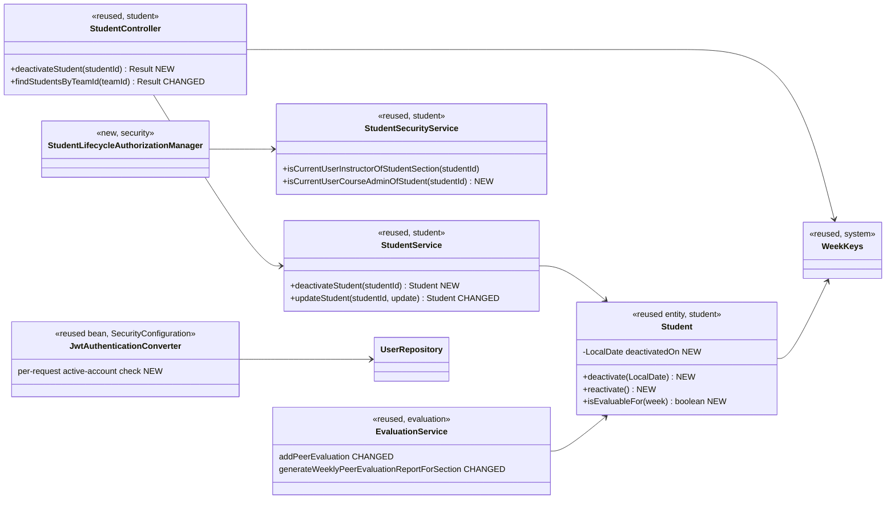
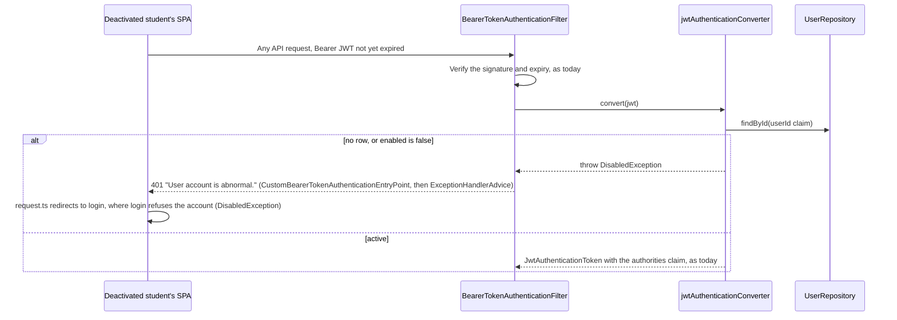
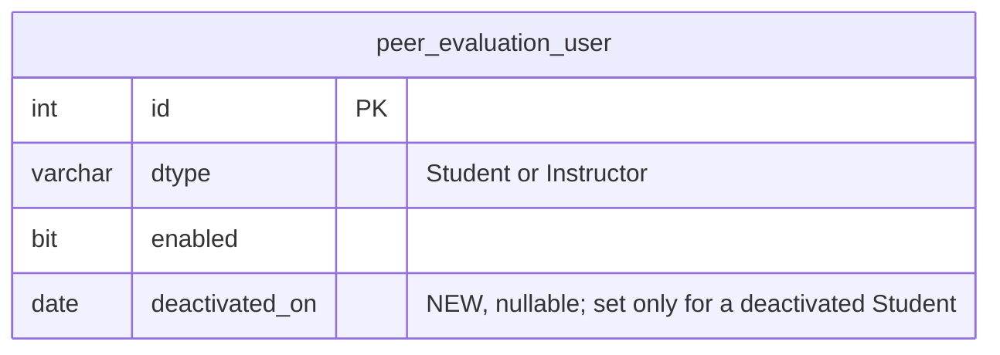

# Student (STU) Design

> Realizes: UC-STU-deactivate-student
> Depends on: FR-SEC-active-account, FR-SEC-deny-unauthorized, BR-student-lifecycle, BR-submission-owed, BR-deactivated-student-evaluation, BR-section-scoped-access, BR-role-based-access
> See: [use cases](../requirements/use-cases.md#student), [SRS security FRs](../requirements/software-requirements-specification.md#security-and-authorization-requirements), [architectural-design.md](architectural-design.md#shared-foundation-components) (shared foundation component view, Crosscutting Concepts)
> Designed against `main` at `59f0267` (2026-10-27).

## Overview

This area covers a student's account in a course section: finding, viewing, deleting, deactivating and reactivating it. The code lives in the foundation's `student` package, in the REST API container. This doc covers deactivation. A course admin or instructor deactivates a student with a dedicated action. The action records the date, so the `evaluation` package can apply BR-deactivated-student-evaluation, and the security filter chain refuses the student's next request even if her token has not expired.

Before this design, deactivation was a side effect of the `enabled` switch on the generic `PUT /students/{studentId}` (`StudentService.updateStudent`). That route recorded no date and had no "already deactivated" path. It also denied a course admin who is not assigned to the course section. Only login checked `enabled`, so a session opened before deactivation kept working until its token expired, up to 2 hours later.

## Components & classes



- **Backend, `student/`:** `Student` gains `deactivatedOn` and three methods; `StudentService.deactivateStudent` (injects the `Clock`), which throws a new `StudentAlreadyDeactivatedException` for 3b; `StudentController.deactivateStudent`; `StudentSecurityService.isCurrentUserCourseAdminOfStudent` (the student's `section.course.courseAdmin` is the caller, whose id comes from `UserUtils`, failing closed on an unknown id); `StudentDto` gains `deactivatedOn` and `evaluable`, both nullable, and `StudentToStudentDtoConverter` fills `deactivatedOn`.
- **Backend, `security/`:** new `authorizationmanagers/StudentLifecycleAuthorizationManager` (reads `studentId`; admits `isCurrentUserInstructorOfStudentSection || isCurrentUserCourseAdminOfStudent`). `SecurityConfiguration` gains the route rule, placed with the other `/students/{studentId}` rules (no broader `/students/**` matcher exists), and the active-account check in its existing `jwtAuthenticationConverter` bean. `GET /students/{studentId}` becomes `anyOf(userOwnershipAuthorizationManager, studentLifecycleAuthorizationManager)`, so the course admin who owns the course can open the student (step 2), as BR-section-scoped-access already allows.
- **Backend, `evaluation/`:** `EvaluationService.addPeerEvaluation` and `generateWeeklyPeerEvaluationReportForSection` call `Student.isEvaluableFor(week)`.
- **Migration:** `db/migration/V7__student_deactivated_on.sql`.
- **Seed (`seed/DataInitializer`):** the seed has no disabled student today. Add one, made with `deactivate(date)` and never with `setEnabled(false)`, on a team in section 2, with her date inside the fixed clock's week, so the tests have a deactivated teammate.
- **Reused unchanged:** `notification/SubmissionStatusService` already counts only students whose account is active, as owing and as teammates (BR-submission-owed), so reminders and the "has not submitted" lists change with no code; `ExceptionHandlerAdvice` (`AccountStatusException` → `401`); `request.ts` (redirects to login on `401`); `WeekKeys`; the `Clock` bean.
- **Frontend:** `apis/student/index.ts` gains `deactivateStudent(id)`, and its `Student` type gains `deactivatedOn` and `evaluable`. In `pages/students/EditStudentForm.vue`, the Status switch is replaced: an active student shows a **Deactivate** button, and a deactivated student shows "Deactivated on {date}" with an interim **Re-enable** button. `pages/evaluations/SubmitTeamsEvaluations.vue` offers a teammate only when `evaluable` is `true`. `Students.vue` keeps its Enabled/Disabled tag.

## Sequence

### UC-STU-deactivate-student: deactivate a student

```mermaid
sequenceDiagram
    actor A as Instructor or course admin
    participant SPA as EditStudentForm (Students.vue dialog)
    participant AM as StudentLifecycleAuthorizationManager
    participant SC as StudentController
    participant SS as StudentService
    participant ST as Student
    A->>SPA: Open the student (steps 1-2, UC-STU-view-student)
    SPA-->>A: Deactivate button, shown only while the student is enabled
    A->>SPA: Deactivate (step 3)
    SPA-->>A: ElMessageBox.confirm stating every consequence (step 4)
    alt Cancel (4a)
        SPA-->>A: Dialog stays open, no request sent
    else Confirm (step 5)
        SPA->>AM: POST /students/{studentId}/deactivation
        alt neither an assigned instructor nor the course admin of the course (3a)
            AM-->>SPA: 403
            SPA-->>A: request.ts toasts the message and opens the forbidden page (3a1)
        else permitted
            AM->>SC: pass
            SC->>SS: deactivateStudent(studentId)
            alt already deactivated (3b)
                SS-->>SPA: 409 "This student is already deactivated."
                SPA-->>A: request.ts toasts the message; the form catches the rejection, closes, and the list reloads (3b1)
            else active
                SS->>ST: deactivate(LocalDate.now(clock))
                Note over ST: enabled = false, deactivatedOn = today, team unchanged (POST-1, POST-3, POST-4)
                SC-->>SPA: 200, updated StudentDto
                SPA-->>A: "{First Last} has been deactivated.", the dialog closes and the list reloads (step 6)
            end
        end
    end
```

The confirmation (step 4) states each consequence in the use case's Associated Information in plain words. She can no longer log in, and a session she has open stops working. She stays on her team. She no longer owes weekly activity reports or peer evaluations and is not reminded of them, and her teammates no longer owe evaluations of her. Her teammates cannot evaluate her for this week or any later week, and the peer evaluation report shows her only for earlier weeks. Her work is kept. She can be reactivated. Deactivation is not deletion. Buttons: **Deactivate** and **Cancel**.

### FR-SEC-active-account: the deactivated student's open session (POST-2)



## API contract

| Endpoint or job | Caller (who may) | Request | Success | Errors, by extension |
|---|---|---|---|---|
| `POST /api/v1/students/{studentId}/deactivation` | An instructor assigned to the student's course section, or the course admin who owns its course (BR-student-lifecycle, BR-section-scoped-access): `StudentLifecycleAuthorizationManager`, a route rule placed before the `denyAll()` catch-all | Path only, no body | `200`: the updated `StudentDto`, with `enabled: false` and `deactivatedOn` set | 3a: `403` in the `Result` envelope (FR-SEC-deny-unauthorized), row unchanged. 3b: `409 CONFLICT`, "This student is already deactivated.", row unchanged. An unknown `studentId` gets `403`, because the manager fails closed as `StudentSecurityService` already does |
| `PUT /api/v1/students/{studentId}` (changed, interim) | Unchanged (`userOwnershipAuthorizationManager`; only `ROLE_instructor` may change `enabled`) | Unchanged; the form keeps sending the student's current `enabled` | `enabled` equal to the stored value changes nothing about the account, so editing a deactivated student's name works. `enabled: true` on a deactivated student calls `reactivate()`, which clears `deactivatedOn` | `enabled: false` on an active student: `400 INVALID_ARGUMENT`, "Use Deactivate to deactivate a student." This interim path is retired when UC-STU-reactivate-student is designed |
| `GET /api/v1/students/teams/{teamId}` (changed) | Unchanged (`teamMembershipAuthorizationManager`) | Unchanged | Each student also carries `evaluable`: whether she may be evaluated for the previous week (`WeekKeys.previousWeek(clock)`), the week the evaluation form rates. The controller sets `deactivatedOn` to null on this route after conversion, so teammates never receive it. The form offers a teammate only when `evaluable === true` | Unchanged |
| `POST /api/v1/evaluations` (changed) | Unchanged | Unchanged | Unchanged | The evaluatee is not `isEvaluableFor(week)`: `400`, "{First} was deactivated and cannot be evaluated for this week." (BR-deactivated-student-evaluation) |
| Every bearer-authenticated request | Any caller | — | Unchanged | The account named by the `userId` claim is deactivated or no longer exists: `401`, "User account is abnormal." (FR-SEC-active-account) |
| `GET /api/v1/evaluations/sections/{sectionId}/week/{week}` (changed) | Unchanged | Unchanged | A deactivated student has a row only for weeks with `isEvaluableFor(week)` true. Evaluations she wrote of others are unchanged in their rows | Unchanged |

## Key decisions

**A dedicated action, not the generic edit.** Deactivation is its own `POST …/deactivation`, which records the date, returns 3b, and carries the BR-student-lifecycle authorization. Rejected: keeping `enabled` on `PUT /students/{studentId}`. That route records no date, has no "already deactivated" answer, and admits only instructors assigned to the course section, so a course admin who isn't assigned is refused.

**The generic edit can only re-enable, until reactivation is designed.** The `PUT` refuses to turn `enabled` off, so nothing deactivates a student without recording the date. It still turns a deactivated student back on through `reactivate()`, so a mistaken deactivation can be undone. Rejected: dropping `enabled` from the `PUT`, which leaves no way back except SQL until UC-STU-reactivate-student is built. Rejected: designing reactivation here, which is its own use case with its own email step (its step 6) and deserves its own review.

**One invariant, held by the entity.** For a student, `enabled` is false exactly when `deactivatedOn` is set. `Student.deactivate(date)` and `Student.reactivate()` are the only writers of either field for a student, so no service sets `enabled` directly. The date is `LocalDate.now(clock)`, which is calendar time under Crosscutting Concepts, so the `dev` fixed clock moves it too.

**One evaluability rule.** `Student.isEvaluableFor(week)` is `enabled || week < WeekKeys.of(deactivatedOn)`. Week keys are ISO (`WeekKeys`: Monday start, week-based year) and of the form `YYYY-Www`, so they order as strings, and this means the week ended before the date of her deactivation (BR-deactivated-student-evaluation). `deactivatedOn` comes from the `Clock`, so it is a date in `app.timezone`, the same zone that names the weeks. `addPeerEvaluation`, the section report and the teammate list all call it. Rejected: one check per caller, which would let the form and the server disagree.

**The server decides whether the evaluation form offers a teammate.** The teammate list carries `evaluable`, computed for the previous week, and the form offers her only when it is true. For example, a student deactivated on Wednesday of week 9 is still evaluable for week 8, which her teammates rate during week 9. Rejected: hiding teammates whose `enabled` is false, which contradicts BR-deactivated-student-evaluation in exactly that case. Rejected: sending her deactivation date to the form and comparing weeks there, which duplicates the rule client-side and shows teammates the date.

**The active-account check runs on every bearer request, in the `jwtAuthenticationConverter`.** The converter loads the user named by the `userId` claim and throws `DisabledException` when the account is deactivated or gone. The existing entry point and `ExceptionHandlerAdvice` turn that into a `401`, and the SPA already redirects to login on a `401`. This realizes FR-SEC-active-account for students and instructors alike, at one primary-key read per request. For deactivated accounts it closes part of [TD-jwt-revocation](architectural-design.md#risks-and-technical-debt); a leaked token for an active account is still valid for its full 2 hours. Rejected: a revocation list or a token version, which add state to keep and clean up. Rejected: shorter token lifetimes, which shrink the window but still miss "her next request". **This changes platform-tier sections of the architecture-of-record (Crosscutting Concepts > Authentication, the authorized-request runtime view, TD-jwt-revocation). Per `/design`, those sections are amended in a separate change, not by this design.**

**Refusals come at confirm, not before the warning.** The use case places 3a and 3b at step 3. The form shows Deactivate only for an enabled student, which covers 3b in the normal case, and the server refuses both at the `POST`, after the warning. The warning changes nothing, so a refusal after it still leaves the account unchanged (3a2, 3b2). Rejected: a pre-check endpoint called before the warning, which adds a route for a rare case.

**Authorization through a new manager.** `StudentLifecycleAuthorizationManager` admits the assigned instructor or the course admin of the student's course. Rejected: `UserOwnershipAuthorizationManager`, which also admits the student herself and checks only assigned instructors. Rejected: `StudentInstructorAuthorizationManager` alone, for the same course-admin gap. The same gap blocks the course admin at step 2, so `GET /students/{studentId}` also admits this manager. The interim `PUT` keeps its current rule, so until UC-STU-reactivate-student is built only an assigned instructor can re-enable. Accepted, because the rule is interim.

## Data model

Delta only. `Student` and its course section and team are as the SRS's [Business Domain Model](../requirements/software-requirements-specification.md#business-domain-model) defines them.



`V7__student_deactivated_on.sql` adds `deactivated_on DATE NULL` to `peer_evaluation_user`. The table is single-table inheritance, and the column is mapped on `Student` only, since instructor deactivation (BR-instructor-lifecycle) needs no date. The same migration backfills `CURRENT_DATE` for rows with `dtype = 'Student' AND enabled = 0`. That keeps the invariant, and students disabled before this change stay in past weeks' reports. The `dev` profile builds its schema with `ddl-auto: create`, so the column comes from the mapping there.

## Reuse & cross-cutting

- Owed items and reminders: `SubmissionStatusService` (NOT area, [not.md](not.md)) already filters on `isEnabled()`, so POST-4's "no longer owes" and the end of reminders need no change.
- Authorization: `StudentSecurityService`, wrapped by a thin manager in the existing pattern.
- Errors: `IllegalArgumentException` → `400 INVALID_ARGUMENT` and `AccountStatusException` → `401`, both existing in `ExceptionHandlerAdvice`. No existing exception means "already in that state", so `ExceptionHandlerAdvice` gains a handler mapping `StudentAlreadyDeactivatedException` to `409 CONFLICT` with its message.
- Time: the injected `Clock` and `WeekKeys`.

## Tests

| Use case, flow | Level | Asserts |
|---|---|---|
| UC-STU-deactivate-student main | integration | An instructor assigned to the course section posts `…/deactivation`: `200`, `enabled` false, `deactivatedOn` is the fixed clock's date |
| UC-STU-deactivate-student main, course admin | integration | The course admin who owns the course but is not assigned to the course section gets `200` on `GET /students/{studentId}` (step 2) and on the deactivation |
| UC-STU-deactivate-student 3a | integration | An unassigned instructor, a course admin of another course, the student herself, and another student each get `403` in the `Result` envelope; the row is unchanged |
| UC-STU-deactivate-student 3b | integration | A second deactivation gets `409`; `deactivatedOn` is unchanged |
| UC-STU-deactivate-student 4a | E2E (Cypress, API stubbed) | Cancel at the confirmation sends no request |
| UC-STU-deactivate-student step 4 | E2E (Cypress, API stubbed) | The confirmation contains one sentence for each consequence listed under the sequence diagram (matched on a key phrase per sentence: "log in", "team", "owes", "evaluate", "report", "kept", "reactivated") |
| UC-STU-deactivate-student step 6 | E2E (Cypress, API stubbed) | After a `200`, the success message names the student, the dialog closes, and the list shows her as Disabled; reopening her shows "Deactivated on {date}" |
| POST-2, FR-SEC-active-account | integration | A token issued before deactivation gets `401` on its next request; a login afterwards gets `401` |
| FR-SEC-active-account, instructor | integration | A token of an instructor whose `enabled` is set false gets `401` on its next request |
| POST-3, POST-4 | integration | After deactivation her team, weekly activity reports and peer evaluations are unchanged |
| BR-deactivated-student-evaluation, submission | unit | Evaluating her for the week that contains her deactivation date gets `400`; for the week before, the evaluation is saved |
| BR-deactivated-student-evaluation, report | integration | The section report includes her for a week before her deactivation and omits her for that week and later |
| BR-deactivated-student-evaluation, form | integration (teammate list) and E2E (Cypress, API stubbed) | A teammate whose previous week ended before her deactivation date comes back `evaluable: true` and is offered in the form; one deactivated during the week being rated comes back `evaluable: false` and is not offered; `deactivatedOn` is absent from the teammate list |
| BR-submission-owed | integration | After deactivation she is not listed as owing, and teammates who evaluated every other active teammate do not owe an evaluation of her (regression on `SubmissionStatusService`) |
| Interim re-enable | integration | `PUT` with `enabled: true` on a deactivated student clears `deactivatedOn`; `PUT` with `enabled: false` on an active student gets `400`; `PUT` renaming a deactivated student (`enabled: false`) succeeds and leaves `deactivatedOn` unchanged |
| Migration backfill | manual, on the staging deploy | Flyway applies V7 cleanly, and every student with `enabled = 0` has a `deactivated_on`. The integration tests run the `dev` profile, whose schema comes from `ddl-auto: create`, so they cannot exercise the backfill |

## Open questions / risks

- **One extra read per request.** Each bearer request loads the user by primary key. That is negligible at course scale (about 80 students); not measured.
- **The `401` message.** "User account is abnormal." is vague for a student whose account was deactivated. The use case sets no text, so it is left as it is.
- **No email to the student.** The use case doesn't notify her, so this design sends none (reactivation does notify, its step 6).
- **Architecture-of-record lags this design** until the follow-up amends its platform-tier sections (see the last key decision).
